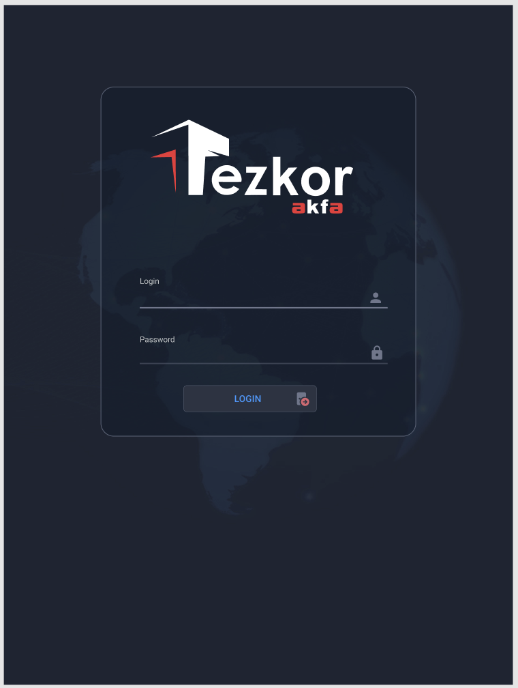
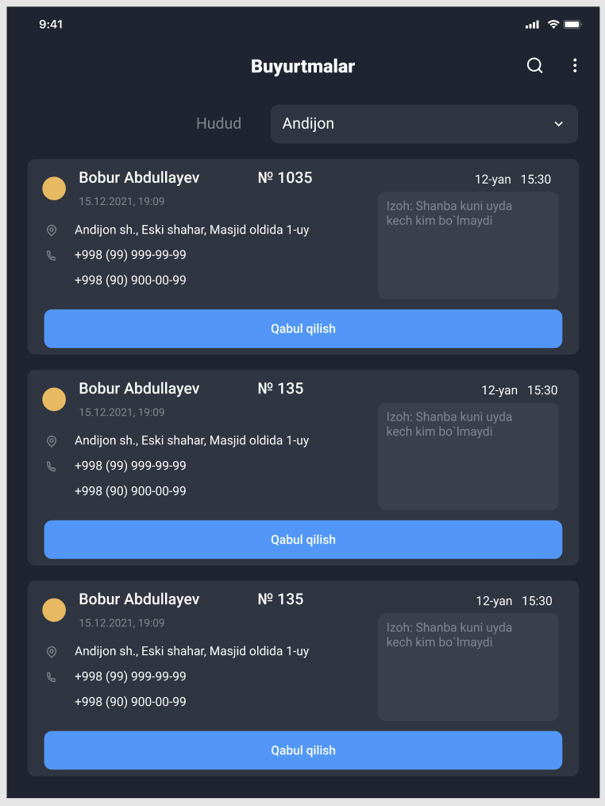
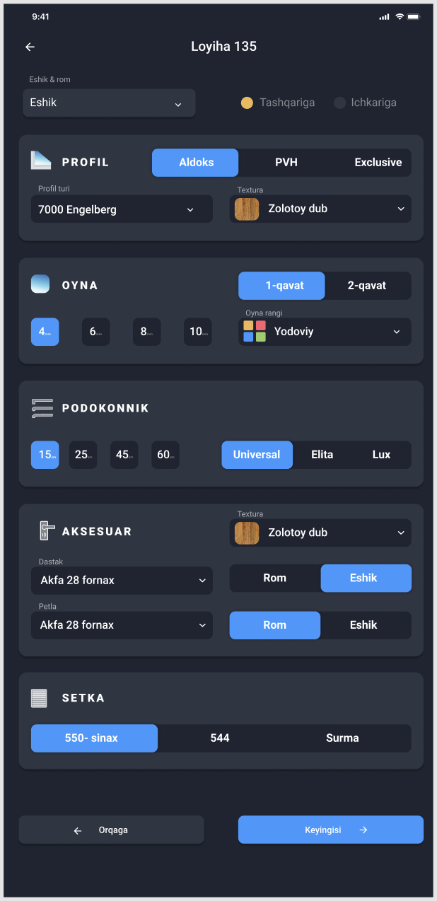
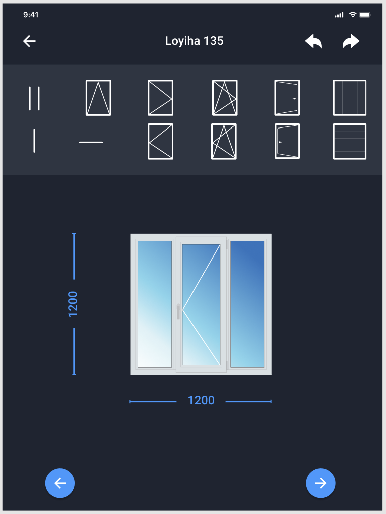
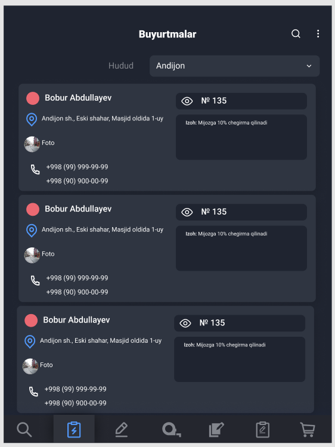

# Tezkor Akfa

A Kotlin Android client for door and window manufacturing workflows. The source contains role-specific screens for measurement, installation, service, and supplier operations.

## Main workflows

- Sign in and load role-specific screens.
- Browse and confirm orders, collect measurement details, and select product types and quantities.
- Capture customer photos, locations, and signatures, and manage drawings/PDF files.
- View installation and service orders.
- Review supplier products, purchasing history, and money records.

## Technology and structure

The app uses XML layouts with ViewBinding, Android Navigation, ViewModels, Retrofit/OkHttp, Dagger 2, Room, and Firebase analytics/crash reporting.

- [presenter](app/src/main/java/uz/algorithmgateway/tezkorakfa/presenter) contains the role-based UI and ViewModels.
- [data/retrofit](app/src/main/java/uz/algorithmgateway/tezkorakfa/data/retrofit) defines API clients, request/response models, and repositories.
- [data/local](app/src/main/java/uz/algorithmgateway/tezkorakfa/data/local) contains Room storage for drawing/PDF records.
- [di](app/src/main/java/uz/algorithmgateway/tezkorakfa/di) wires the dependencies.

## Development requirements

The checked-in build uses Android Gradle Plugin 7.1.3, Kotlin 1.6.21, Gradle 7.2, compile/target SDK 31, and minimum SDK 23. Open the repository in Android Studio with a compatible toolchain.

A working development setup also needs a compatible application backend, authorized test accounts, and Firebase configuration for the package. Review the `BASE_URL` build configuration and supply service configuration for a development environment you control. The source requests camera, location, and storage access for its document and field-work screens.

## Project status

This repository contains the Android client, not the server implementation. Backend availability, credentials, and device behavior have not been verified as part of this documentation update. Use a development backend when exploring workflows that create or modify business records.

## Screenshots

